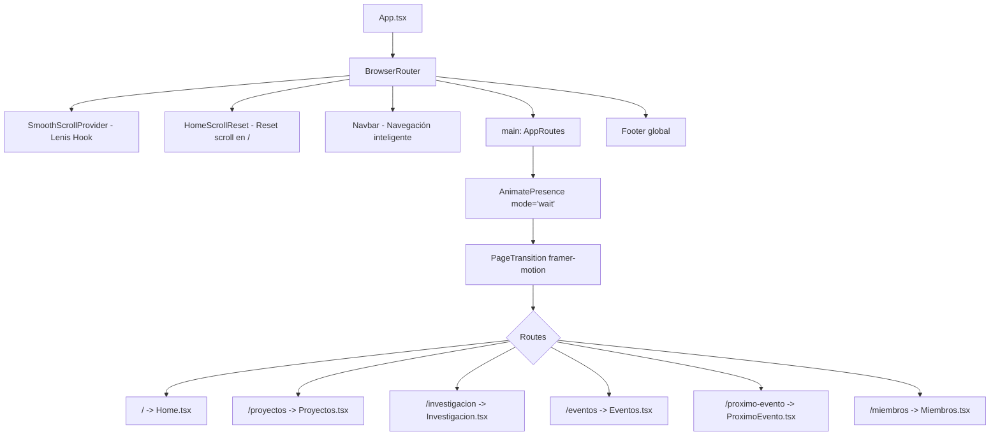
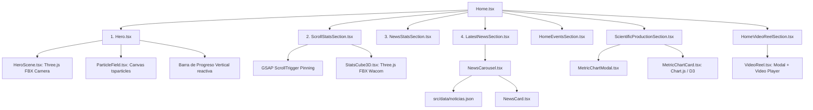

# 🚀 Plataforma Web MediaShow — Ingeniería Multimedia USB

Documentación técnica, arquitectónica y funcional del repositorio de la plataforma web del **Programa de Ingeniería Multimedia** de la **Universidad de San Buenaventura (Sede Bogotá)** y su evento insignia **MediaShow**.

---

## 📋 Tabla de Contenidos
1. [Visión General del Proyecto](#1-visión-general-del-proyecto)
2. [Stack Tecnológico](#2-stack-tecnológico)
3. [Estructura y Organización del Repositorio](#3-estructura-y-organización-del-repositorio)
4. [Arquitectura de Enrutamiento y Páginas](#4-arquitectura-de-enrutamiento-y-páginas)
5. [Diagnóstico Crítico: Páginas y Componentes Faltantes por Conectar](#5-diagnóstico-crítico-páginas-y-componentes-faltantes-por-conectar)
6. [Cómo se Conectan los Componentes (Flujo de Datos e Interacción)](#6-cómo-se-conectan-los-componentes-flujo-de-datos-e-interacción)
7. [Sistema de Diseño, Gráficos y 3D](#7-sistema-de-diseño-gráficos-y-3d)
8. [Comandos y Guía de Desarrollo](#8-comandos-y-guía-de-desarrollo)
9. [Hoja de Ruta Recomendada (Checklist de Integración)](#9-hoja-de-ruta-recomendada-checklist-de-integración)

---

## 1. Visión General del Proyecto

Esta aplicación es una experiencia web interactiva, moderna y de alto impacto visual orientada a:
- Difundir la producción académica, investigativa y creativa del **Programa de Ingeniería Multimedia**.
- Presentar semilleros de investigación (**GameDev**, **Animove**, **StoryLab**).
- Publicar la agenda de eventos y gestionar la divulgación del congreso/muestra **MediaShow**.
- Exhibir proyectos destacados (realidad virtual, computación gráfica, videojuegos, transmedia).
- Integrar elementos 3D interactivos en tiempo real con modelos FBX (cámara broadcast Sony, tableta digitalizadora Wacom), partículas y animaciones basadas en scroll sincronizado.

---

## 2. Stack Tecnológico

| Capa / Tecnología | Versión / Librería | Propósito |
| :--- | :--- | :--- |
| **Framework Base** | React 19 + React DOM 19 | Renderizado de interfaz reactiva basado en componentes funcionales. |
| **Bundler & Build** | Vite 8 + TypeScript 5.7 | Entorno de compilación ultra-rápido, tipado estático y HMR. |
| **Enrutador** | React Router v7 (`react-router-dom` 7.18) | Enrutamiento del lado del cliente (SPA) con `BrowserRouter`. |
| **Estilos & Diseño** | Tailwind CSS v4 (`@tailwindcss/vite`) | Utilidades atómicas, variables CSS y tokens de diseño. |
| **3D & WebGL** | Three.js (0.185) + `@react-three/fiber` / `@react-three/drei` | Carga de modelos FBX, texturizado PBR, cámaras e iluminación 3D. |
| **Animación & Física** | Framer Motion (12.43) | Transiciones entre páginas, componentes dinámicos y microinteracciones. |
| **Scroll Suave & Triggers** | Lenis (1.3.27) + GSAP 3 (ScrollTrigger) | Scroll inercial suave y animaciones sincronizadas al desplazamiento. |
| **Gráficos & Métricas** | Chart.js 4 + `react-chartjs-2` + D3 (7.9) | Visualización interactiva de estadísticas de investigación y métricas. |
| **Partículas** | `@tsparticles/react` + `@tsparticles/slim` | Efecto de partículas dinámicas en el Hero principal. |

---

## 3. Estructura y Organización del Repositorio

El código fuente se encuentra estructurado en capas modulares bajo `src/`:

```
MultimediaPage/
├── .figma/                     # Configuraciones y utilidades de despliegue/entorno Figma Make
├── scripts/
│   └── fix.cjs                 # Script auxiliar de reemplazo de rutas de importación
├── src/
│   ├── assets/                 # Recursos 3D y texturas de alta resolución
│   │   ├── Models/
│   │   │   ├── Camera Sony XDCAM 4K.fbx    # Modelo 3D de la cámara principal (Hero)
│   │   │   └── WACOM V1.fbx                # Modelo 3D de la tableta Wacom (ScrollStats)
│   │   └── texturas/           # Mapas PBR (BaseColor, Normal, Metallic, Roughness, Height)
│   │       ├── Extra/          # Texturas de cámara y tela
│   │       ├── Zoom1/          # Texturas del lente zoom 1
│   │       └── Zoom2/          # Texturas del cuerpo zoom 2
│   ├── components/
│   │   ├── graphics/           # Componentes WebGL / Canvas / Visualización
│   │   │   ├── HeroScene.tsx           # Escena 3D con Three.js (Cámara Sony interactiva)
│   │   │   ├── ParticleField.tsx       # Lienzo de partículas dinámicas (tsparticles)
│   │   │   ├── StatsChart.tsx          # Gráfico de líneas/barras (Chart.js)
│   │   │   ├── StatsCube3D.tsx         # Renderizador del modelo 3D Wacom interactivo
│   │   │   └── VideoReel.tsx           # Modal y reproductor de video reel
│   │   ├── sections/           # Secciones grandes compuestas por página
│   │   │   ├── common/                 # Secciones reutilizables o de Home
│   │   │   │   ├── FeaturedProjectsSection.tsx  # [HUÉRFANO] Catálogo filtrable de proyectos
│   │   │   │   ├── Hero.tsx                     # Cabecera principal con 3D y barra vertical
│   │   │   │   ├── HomeEventsSection.tsx        # Sección de agenda de eventos en Home
│   │   │   │   ├── HomeNextEventCTA.tsx         # [HUÉRFANO] Banner de llamado al próximo evento
│   │   │   │   ├── HomeVideoReelSection.tsx     # Sección de video reel en Home
│   │   │   │   ├── LatestNewsSection.tsx        # Sección de noticias con carrusel
│   │   │   │   ├── NewsStatsSection.tsx         # Estadísticas destacadas de novedades
│   │   │   │   ├── ScientificProductionSection.tsx # Producción científica y modal de métricas
│   │   │   │   └── ScrollStatsSection.tsx       # Sección fijada por GSAP ScrollTrigger + 3D
│   │   │   ├── eventos/                # Secciones exclusivas de /eventos
│   │   │   │   ├── EventsGridSection.tsx        # Catálogo interactivo con filtros y búsqueda
│   │   │   │   └── EventsHeroSection.tsx        # Banner hero de la agenda de eventos
│   │   │   ├── investigacion/          # Secciones de /investigacion
│   │   │   │   └── SemillerosSection.tsx        # Pestañas de semilleros (GameDev, Animove, StoryLab)
│   │   │   ├── miembros/               # Secciones de /miembros (actualmente vacío / .gitkeep)
│   │   │   └── proximo-evento/         # Secciones exclusivas de /proximo-evento
│   │   │       ├── NextEventHeroSection.tsx     # Hero con cuenta regresiva en vivo
│   │   │       ├── NextEventProgramSection.tsx  # Agenda detallada y cronograma por horas
│   │   │       ├── NextEventRegistrationSection.tsx # Formulario y ficha de inscripción
│   │   │       ├── NextEventSpeakersSection.tsx # Ponentes y conferencistas magistrales
│   │   │       └── NextEventVideoSection.tsx    # Video teaser y tráiler del evento
│   │   └── ui/                 # Sistema de componentes atómicos de interfaz
│   │       ├── Badge.tsx               # Etiquetas con variantes y estado de pulso
│   │       ├── Button.tsx              # Botón tecnológico con marcos angulares animados
│   │       ├── Card.tsx                # Tarjetas contenedoras con bordes de acento y sombras
│   │       ├── CountdownTimer.tsx      # Contador regresivo (días, horas, minutos, segundos)
│   │       ├── EventCard.tsx           # Tarjeta de evento académico
│   │       ├── FilterPills.tsx         # Selector de píldoras de filtrado
│   │       ├── MemberCard.tsx          # Tarjeta de integrante (docente/estudiante/egresado)
│   │       ├── MetricChartCard.tsx     # Tarjeta que despliega gráficos métricos
│   │       ├── MetricChartModal.tsx    # Modal emergente con gráfica Chart.js
│   │       ├── Navbar.tsx              # Barra de navegación flotante e inteligente
│   │       ├── NewsCard.tsx            # Tarjeta de noticia individual
│   │       ├── NewsCarousel.tsx        # Carrusel animado con Framer Motion para noticias
│   │       ├── NewsStatCard.tsx        # Métrica estadística de novedades
│   │       ├── PageBanner.tsx          # Banner genérico de cabecera para subpáginas
│   │       ├── ResearchCard.tsx        # Tarjeta de proyecto de investigación
│   │       ├── SectionHeader.tsx       # Encabezado estándar de sección (título, subtítulo, acento)
│   │       └── SpeakerCard.tsx         # Tarjeta de ponente / invitado
│   ├── data/
│   │   └── noticias.json       # Datos en JSON para artículos, categorías y fechas
│   ├── hooks/
│   │   └── useParallax.ts      # Integración de Lenis Scroll, GSAP Ticker y ScrollTrigger
│   ├── imports/                # Recursos gráficos de marca y documentos
│   │   ├── Animove_Logo.png    # Logo semillero Animove
│   │   ├── Gamedev_Logo.png    # Logo semillero GameDev
│   │   ├── StoryLab_Logo.png   # Logo semillero StoryLab
│   │   ├── MediaShow.png       # Logo oficial MediaShow
│   │   └── Media_Show_2023-1.pdf # Documento PDF descargable de memorias
│   ├── pages/                  # Vistas principales vinculadas a rutas
│   │   ├── Eventos.tsx         # Vista del catálogo general de eventos
│   │   ├── Home.tsx            # Vista principal aterrizaje (7 secciones enlazadas)
│   │   ├── Investigacion.tsx   # Vista de proyectos científicos y semilleros
│   │   ├── Miembros.tsx        # Directorio de docentes, investigadores y alumnos
│   │   ├── ProximoEvento.tsx   # Landing page oficial de la siguiente edición de MediaShow
│   │   └── Proyectos.tsx       # [EN CONSTRUCCIÓN] Catálogo de proyectos destacados
│   ├── styles/                 # Capa de estilos CSS y tokens de diseño
│   │   ├── global.css          # Reglas base, fondos en rejilla (`grid-bg`), utilidades
│   │   ├── tokens.css          # Paleta de color oficial (Primary, Secondary, Tertiary, Neutral)
│   │   └── typography.css      # Jerarquía de fuentes y escalas de texto
│   ├── types/
│   │   └── assets.d.ts         # Declaraciones TypeScript para `.fbx`, `.png`, `.pdf`
│   ├── App.tsx                 # Orquestador raíz: Router, Layout, SmoothScroll y Footer
│   ├── index.css               # Entrada CSS global con `@import 'tailwindcss';`
│   └── main.tsx                # Punto de entrada React 19 (`createRoot`)
├── index.html                  # Shell HTML de Vite
├── package.json                # Dependencias y scripts de ejecución
├── tsconfig.json               # Configuración de TypeScript y paths (`@/*` -> `./src/*`)
└── vite.config.ts              # Configuración Vite con plugins Tailwind v4, React y assets FBX
```

---

## 4. Arquitectura de Enrutamiento y Páginas

Las rutas están declaradas en `src/App.tsx` utilizando `Routes` y `Route` de `react-router-dom`:

| Ruta (URL) | Componente Página | Archivo Fuente | Estado de Conexión en UI | Descripción Funcional |
| :--- | :--- | :--- | :--- | :--- |
| `/` | `<Home />` | `src/pages/Home.tsx` | ✅ Conectada en Navbar y Footer | Página principal con narrativa de 7 secciones (Hero 3D, Estadísticas fijadas por scroll con modelo Wacom, noticias, eventos y producción científica). |
| `/proximo-evento` | `<ProximoEvento />` | `src/pages/ProximoEvento.tsx` | ✅ Conectada en Navbar y botones de Home | Landing dedicada al próximo encuentro de MediaShow con cronograma, ponentes internacionales y registro. |
| `/eventos` | `<Eventos />` | `src/pages/Eventos.tsx` | ⚠️ **Desconectada del Navbar** | Catálogo general de eventos con buscador por texto y píldoras de filtrado por categoría (`conferencia`, `taller`, `panel`, `charla`). |
| `/investigacion` | `<Investigacion />` | `src/pages/Investigacion.tsx` | ⚠️ **Desconectada del Navbar** | Proyectos científicos filtrables (`activo`, `concluido`, `en-revision`), semilleros y gráficas de publicaciones. |
| `/miembros` | `<Miembros />` | `src/pages/Miembros.tsx` | ⚠️ **Desconectada del Navbar** | Directorio del cuerpo docente, egresados y estudiantes categorizados con tarjetas de perfil. |
| `/proyectos` | `<Proyectos />` | `src/pages/Proyectos.tsx` | ⚠️ **Página Vacía / Placeholder** | Existe la ruta y recibe tráfico desde el Hero, pero su contenido actual es solo un mensaje de texto de prueba ("Próximamente..."). |

---

## 5. Diagnóstico Crítico: Páginas y Componentes Faltantes por Conectar

A continuación se detalla todo lo que actualmente se encuentra huérfano, desconectado o pendiente de integración en el repositorio:

### 🔴 1. El Menú de Navegación (`src/components/ui/Navbar.tsx`) está incompleto
- **Problema**: El array `links` del Navbar únicamente contiene 2 elementos:
  ```ts
  const links = [
    { to: "/", label: "HOME" },
    { to: "/proximo-evento", label: "PRÓXIMO EVENTO" },
  ]
  ```
- **Impacto**: Los usuarios no pueden navegar de forma directa a `/investigacion`, `/eventos`, `/miembros` ni `/proyectos`. Las subpáginas quedan ocultas salvo que se acceda mediante botones internos específicos o escribiendo la URL manualmente.
- **Solución necesaria**: Agregar las rutas restantes al array `links` para que se rendericen tanto en el menú de escritorio como en el drawer móvil.

### 🔴 2. La Página `/proyectos` está vacía mientras existe un componente terminado huérfano
- **Problema**: `src/pages/Proyectos.tsx` solo tiene un texto que dice: *"Próximamente: catálogo completo de proyectos estudiantiles y de investigación."*
- **Componente existente sin usar**: `src/components/sections/common/FeaturedProjectsSection.tsx` está **100% implementado** (contiene pestañas interactivas, proyectos reales como *Montes de María*, *Amazonas Transmedia*, *Cyber-Flora*, *Chronos Descent*, etiquetas tecnológicas, animaciones y badges).
- **Solución necesaria**: Conectar `FeaturedProjectsSection` dentro de `src/pages/Proyectos.tsx` y/o enlazarlo dentro de `Home.tsx`.

### 🔴 3. Componente Huérfano `HomeNextEventCTA.tsx`
- **Problema**: `src/components/sections/common/HomeNextEventCTA.tsx` es una tarjeta publicitaria con cuenta regresiva para el evento MediaShow 2026-2 con botón hacia `/proximo-evento`. No está importada en ninguna parte del proyecto.
- **Solución necesaria**: Importarla e insertarla en `src/pages/Home.tsx` (por ejemplo, antes de `ScientificProductionSection` o al final).

### 🔴 4. El Footer (`src/App.tsx`) contiene enlaces de relleno (*Placeholders*)
- **Problema**: En `src/App.tsx`, las 4 columnas del pie de página (*Contacto*, *Menu Principal*, *Noticias*, *Semilleros*) tienen enlaces que dicen repetitivamente `"Información"` y apuntan a `href="#"`:
  ```tsx
  { title: "Menu Principal", links: ["Información", "Información", "Información", "Información"] }
  ```
- **Solución necesaria**: Reemplazar estos textos por enlaces reales que usen `<NavLink>` o `<Link>` hacia las páginas de la aplicación:
  - *Menu Principal*: Inicio (`/`), Eventos (`/eventos`), Investigación (`/investigacion`), Proyectos (`/proyectos`), Miembros (`/miembros`).
  - *Contacto*: Correo institucional, ubicación del campus de la USB Bogotá, redes sociales oficiales.
  - *Semilleros*: Enlaces directos o anchors a GameDev, Animove y StoryLab.

### 🔴 5. El Formulario de Registro en Próximo Evento no persiste datos
- **Problema**: En `src/components/sections/proximo-evento/NextEventRegistrationSection.tsx`, el formulario realiza:
  ```tsx
  const handleSubmit = (e: React.FormEvent) => {
    e.preventDefault()
    if (!formData.name || !formData.email) return
    setSubmitted(true)
  }
  ```
- **Impacto**: No envía la información a ninguna base de datos, backend, webhook o servicio de formularios (e.g. Google Forms API / Supabase / Formspree).

### 🔴 6. Enlaces de Postulación a Semilleros vacíos
- **Problema**: En `src/components/sections/investigacion/SemillerosSection.tsx`, el array `semilleros` tiene la propiedad `formUrl` asignada a cadenas de prueba o vacías (`formUrl: "#"`). El botón "Postularme al Semillero" no redirige a convocatorias activas.

### 🔴 7. Falta de Vistas de Detalle Dinámicas (Rutas con Parámetros)
- Actualmente no existen páginas individuales para ver el detalle de:
  - Una noticia individual: `/noticias/:id` (actualmente solo se visualizan como resumen en el carrusel).
  - Un evento específico: `/eventos/:id` (todos los botones redirigen a `/proximo-evento` o ejecutan scroll).
  - Un proyecto en profundidad: `/proyectos/:id`.

### 🔴 8. Carpeta de Secciones de Miembros vacía
- `src/components/sections/miembros/` solo contiene un `.gitkeep`. Toda la lógica de `Miembros.tsx` está escrita dentro de la página misma en lugar de modularizarse en una sección reutilizable como se hace en las demás páginas.

---

## 6. Cómo se Conectan los Componentes (Flujo de Datos e Interacción)

### 6.1. Flujo Global en `src/App.tsx`


1. **Lenis + GSAP**: `SmoothScrollProvider` inicializa el motor de scroll inercial suave. El ticker de GSAP se sincroniza con el frame loop de Lenis, permitiendo que `ScrollTrigger` calcule con precisión las posiciones de los elementos.
2. **Control de Scroll en Cambios de Ruta**: `HomeScrollReset` detecta cambios en `location.pathname` y resetea el viewport a `(0, 0)` usando `requestAnimationFrame` para que el usuario siempre empiece en el tope de la nueva vista.
3. **Transición Suave de Vistas**: `PageTransition` envuelve cada ruta con animaciones de opacidad y desplazamiento vertical leve (`opacity: 0 -> 1`, `y: 10 -> 0`).

---

### 6.2. Cadena de Secciones en `src/pages/Home.tsx`
La página principal funciona como un recorrido secuencial que va conectando múltiples subsistemas:



- **Sección 1 (`Hero`)**: Integra el componente `HeroScene` que carga de forma asíncrona mediante Three.js el modelo `Camera Sony XDCAM 4K.fbx`, aplicando mapas de normales, rugosidad y metalicidad. Además, calcula el porcentaje de avance de la página y mueve la barra de progreso lateral fija.
- **Sección 2 (`ScrollStatsSection`)**: Fija la pantalla con `ScrollTrigger` y mientras el usuario hace scroll, rota un modelo 3D de una tableta gráfica Wacom (`StatsCube3D`) mostrando cifras históricas del programa (25+ años, 40+ convenios, 250+ estudiantes, 15+ semilleros).
- **Sección 3 & 4 (`NewsStatsSection` & `LatestNewsSection`)**: Importa `noticias.json`, lo entrega al carrusel `NewsCarousel` y formatea etiquetas de estado (`NUEVO`, `LOGRO`, `PUBLICACIÓN`).
- **Sección 5 (`HomeEventsSection`)**: Muestra los eventos más próximos con fechas, ponentes y ubicación en el campus San Buenaventura.
- **Sección 6 (`ScientificProductionSection`)**: Genera gráficos y métricas científicas, conectándose con `MetricChartModal` para expandir información estadística detallada.
- **Sección 7 (`HomeVideoReelSection`)**: Muestra un reproductor multimedia cinematográfico con el reel institucional.

---

### 6.3. Conexiones en `src/pages/Investigacion.tsx`
- **Filtros por Estado**: Mantiene un estado reactivo `active` (`todos`, `activo`, `concluido`, `en-revision`) que filtra el catálogo de proyectos y renderiza cada uno dentro de `ResearchCard`.
- **Subsección de Semilleros (`SemillerosSection`)**: Integra un selector de pestañas entre los semilleros **GameDev** (videojuegos y XR), **Animove** (animación y VFX) y **StoryLab** (narrativas transmedia), mostrando logros, áreas de formación y logos oficiales (`imports/`).
- **Métricas (`StatsChart`)**: Renderiza un componente basado en Chart.js que ilustra la evolución histórica de publicaciones científicas e indexaciones.

---

### 6.4. Conexiones en `src/pages/ProximoEvento.tsx`
Layout estructurado en dos columnas maestras:
- **Columna Izquierda (8 columnas en desktop)**:
  - `NextEventVideoSection`: Muestra el tráiler promocional.
  - `NextEventProgramSection`: Cronograma de conferencias con horarios desglosados (9:00 AM a 5:00 PM).
  - `NextEventSpeakersSection`: Tarjetas individuales `SpeakerCard` con fotografía, rol e institución de los conferencistas.
- **Columna Derecha (4 columnas en desktop - `sticky top-24`)**:
  - `NextEventRegistrationSection`: Ficha flotante persistente con disponibilidad de cupos, enlace de descarga a las memorias en PDF (`Media_Show_2023-1.pdf`) y formulario de registro.

---

### 6.5. Componente Tecnológico Reutilizable: `Button.tsx`
`Button.tsx` implementa un sistema visual tipo *Sci-Fi / Cyberpunk* que incluye:
- **Marco de Esquinas Dinámico**: 4 esquinas dibujadas con Framer Motion (`cornerVariants`) que reaccionan contrayéndose hacia el centro (`pressed`) cuando se hace clic o tap.
- **Variantes de Color del Sistema**: `primary`, `secondary`, `tertiary`, `outline-primary`, `outline-secondary`, `outline-tertiary`, `ghost`.
- **Comportamiento como Enlace (`asLink`)**: Admite propiedades `href`, `target` y `download`.
  > *Nota de Arquitectura*: Al usar `<motion.a href={href}>` nativo, la navegación a rutas internas produce una navegación tradicional de navegador en lugar de aprovechar la transición SPA de `react-router-dom`. Se recomienda migrar a un wrapper con `Link` o `useNavigate`.

---

## 7. Sistema de Diseño, Gráficos y 3D

### 7.1. Paleta de Colores (`src/styles/tokens.css` e `index.css`)
- **Primary (Turquesa / Teal)**: `--color-primary-500: #0e9a93;` (Color institucional principal de ciencia y tecnología).
- **Secondary (Naranja / Ámbar)**: `--color-secondary-500: #d6780a;` (Color de eventos, llamadas a la acción y dinamismo).
- **Tertiary (Azul / Accent)**: `--color-tertiary-500: #2878b0;` (Acentos de soporte e interfaces).
- **Fondos & Superficies**: `--color-bg: #f5f2ee;`, `--color-surface: #ffffff;`, `--color-neutral-900: #1a1714;`.

### 7.2. Jerarquía Tipográfica (`src/styles/typography.css`)
- **Títulos y Encabezados**: `'Zen Dots', sans-serif` (`font-heading`). Aporta una estética futurista, geométrica y de cómputo visual.
- **Etiquetas, Métricas y UI**: `'JetBrains Mono', monospace` (`font-display`). Utilizada en botones, números, etiquetas de estado y fechas.
- **Texto Corrido / Lectura**: `'Outfit', sans-serif` (`font-body`). Tipografía limpia y legible para párrafos y descripciones.

### 7.3. Pipeline 3D (Three.js)
- Los modelos en formato `.fbx` son importados como módulos de Vite gracias a la directiva `assetsInclude: ["**/*.fbx"]` configurada en `vite.config.ts`.
- Se utiliza `FBXLoader` de Three.js emparejado con `TextureLoader` para componer materiales `MeshStandardMaterial` con cálculo de rugosidad, metalicidad y relieves normales en tiempo real.

---

## 8. Comandos y Guía de Desarrollo

### Requisitos Previos
- **Node.js** >= 20.x
- **pnpm** (recomendado) o **npm**

### Comandos de Terminal

```bash
# Instalar dependencias del proyecto
pnpm install

# Iniciar servidor de desarrollo en http://localhost:8443
pnpm dev

# Compilar proyecto para producción (genera carpeta dist/)
pnpm build

# Previsualizar la compilación de producción localmente
pnpm preview

# Ejecutar formateador de código (oxfmt)
pnpm format
```

---

## 9. Hoja de Ruta Recomendada (Checklist de Integración)

Para llevar la plataforma a un estado de completitud total, se recomienda seguir estos pasos ordenados por prioridad:

- [ ] **Paso 1: Sincronizar el Navbar**
  - Abrir `src/components/ui/Navbar.tsx` y actualizar `links`:
    ```ts
    const links = [
      { to: "/", label: "HOME" },
      { to: "/proyectos", label: "PROYECTOS" },
      { to: "/investigacion", label: "INVESTIGACIÓN" },
      { to: "/eventos", label: "EVENTOS" },
      { to: "/proximo-evento", label: "PRÓXIMO EVENTO" },
      { to: "/miembros", label: "MIEMBROS" },
    ]
    ```
- [ ] **Paso 2: Conectar `FeaturedProjectsSection` en `/proyectos`**
  - Importar `FeaturedProjectsSection` dentro de `src/pages/Proyectos.tsx` para reemplazar el texto vacío actual por la galería completa de proyectos.
- [ ] **Paso 3: Integrar `HomeNextEventCTA` en `Home.tsx`**
  - Incluir el banner de llamado a la acción al próximo evento en la página de inicio para mejorar la conversión de asistentes.
- [ ] **Paso 4: Actualizar los enlaces del Footer en `App.tsx`**
  - Reemplazar los textos `"Información"` y enlaces `href="#"` por enlaces reales a las secciones del sitio web y redes del programa.
- [ ] **Paso 5: Modularizar la sección de Miembros**
  - Mover el catálogo de integrantes de `src/pages/Miembros.tsx` a un nuevo componente en `src/components/sections/miembros/MembersDirectorySection.tsx`.
- [ ] **Paso 6: Conectar formulario de inscripción y semilleros a servicios reales**
  - Conectar el formulario de `NextEventRegistrationSection.tsx` a un webhook o Google Form.
  - Asignar los enlaces de registro en `SemillerosSection.tsx` (`formUrl`).
- [ ] **Paso 7: Optimizar `Button.tsx` para navegación SPA**
  - Integrar el componente `Link` de `react-router-dom` cuando `asLink={true}` para evitar recargas completas del navegador al navegar entre rutas internas.
